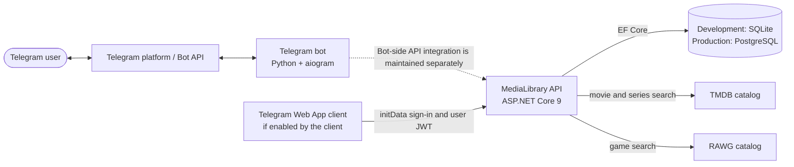
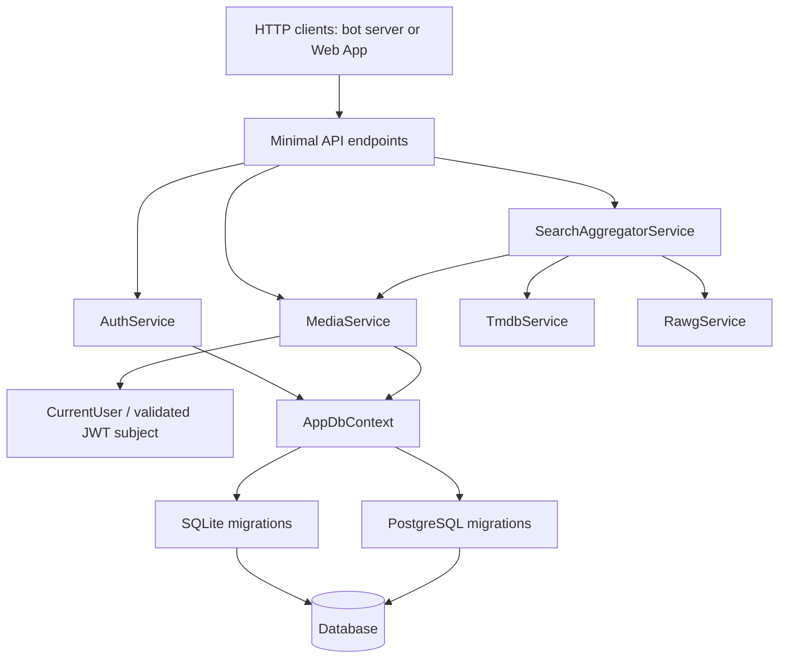
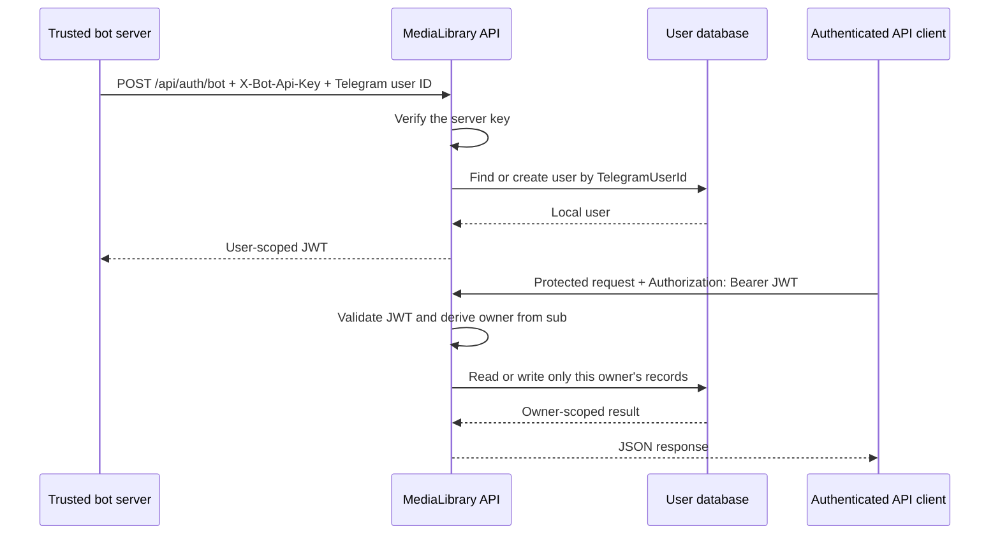

# Media Library

A Telegram-connected personal library for tracking movies, TV series, and games. The repository contains a Telegram bot and a REST API that stores user-owned media, aggregates search results from external catalogs, and exposes statistics and viewing sessions.

> **Deployment status:** Production deployment is live.

## Project components

| Component | Technology | Responsibility |
|---|---|---|
| `api/` | C# 13, .NET 9, ASP.NET Core Minimal APIs | Authentication, owner-scoped media operations, catalog search, statistics, and persistence |
| `bot/` | Python 3.11+, aiogram 3 | Telegram interface for browsing and managing a personal media library |
| Database | SQLite in Development; PostgreSQL in Production | Stores users, media, genres, tags, and viewing sessions |
| External catalogs | TMDB and RAWG | Movie and series search (TMDB), and game search (RAWG) |

The API supports Telegram Web App `initData` authentication and a separate trusted bot-server authentication exchange. Both paths resolve the same application user by Telegram ID and issue the same user-scoped JWT. API endpoints use that JWT to enforce per-user ownership.

## Architecture

<details open>
<summary>System context</summary>



</details>

<details>
<summary>API component view</summary>



</details>

<details>
<summary>Authentication and API request flow</summary>



</details>

## API documentation

- [API overview and local development](./api/README.md)
- [Authentication and ownership](./api/AUTHENTICATION.md)
- [API contract](./CONTRACT.md)
- **Production API:** [https://medialibrary-hkdf.onrender.com/](https://medialibrary-hkdf.onrender.com/)
- **Production Swagger UI:** [https://medialibrary-hkdf.onrender.com/swagger/index.html](https://medialibrary-hkdf.onrender.com/swagger/index.html)
- **Telegram bot:** [@DyvysHray_bot](https://t.me/DyvysHray_bot)
- **Local Swagger UI:** `http://localhost:5021/swagger` when the API is running with the Development HTTP profile.

## Run and test the API locally

Requirements: .NET 9 SDK. From the repository root:

```bash
dotnet restore api/MediaLibrary.sln
dotnet test api/MediaLibrary.sln
```

For an API run, configure a local JWT signing secret and the server-to-server bot key. Keep secrets in User Secrets, not in tracked settings files:

```bash
cd api/MediaLibrary.Api
dotnet user-secrets set "Jwt:Secret" "$(openssl rand -hex 32)"
dotnet user-secrets set "BotAuth:ApiKey" "$(openssl rand -hex 32)"
# Optional: needed when testing Telegram Web App initData sign-in.
dotnet user-secrets set "Telegram:BotToken" "<token from BotFather>"
dotnet run --launch-profile http
```

The API listens on `http://localhost:5021`. The Development profile uses SQLite. Existing migrations are applied automatically at application startup; no manual database update command is required. See [API authentication](./api/AUTHENTICATION.md) for sign-in requests and secret requirements.

## Development stack

- C# 13 / .NET 9, ASP.NET Core Minimal APIs, Entity Framework Core 9
- Python 3.11+, aiogram 3, httpx, and Pydantic v2 for the Telegram bot
- SQLite for local development; PostgreSQL for production
- TMDB for movie and TV series metadata; RAWG for game metadata
- xUnit and EF Core InMemory for API tests

## Contributors

- **Vitalii Marynych** — C# backend and project lead
- **Andrii Mytrovka** — Python Telegram bot
